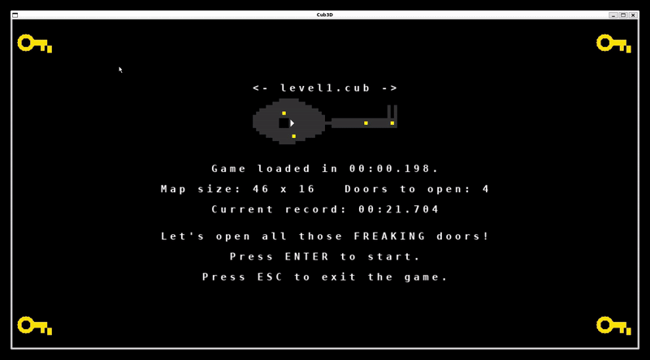

## Description

The goal is to render a ray casting wolfestein-like (1992) maze game in `c` using the `minilibx`. We are following the [Permadi's tutorial](https://permadi.com/1996/05/ray-casting-tutorial-table-of-contents/).

The project includes:

- animations
- open / close doors
- playable with keyboard and mouse
- minimap

Code summary:

| File type | Lines of Code |
|----------|--------------:|
| `.c`     |          2253 |
| `.h`     |           348 |
| `.sh`     |           126 |
| Makefile |            83 |
| **TOTAL**|        **2810** |

## Instructions

To compile and run the game:

```bash
make
./cub3d maps/level[1-9].cub
```

with an existing *.cub file.

The game speed can be adjusted using:

```c
# define MOVE_SPEED 0.00404 (cubes / millisecond)
# define ROT_SPEED  0.00137 (radians / millisecond)
# define MOUSE_SENS 0.00181  (radians / millisecond)
```

The default configuration works nice for the 42 computers at 03/09/2026. 

## Gameplay

The game consists on opening all the doors as fast as posible. Best scores will be saved.

Use `W` `A` `S` y `D` to move the player across the map. To rotate the view angle, use `left arrow` and `right arrow`.

As movement is calculated, moving in diagonal increase movement speed by `sqrt(2)`, ie, `41,42%` faster.

Alternately, you can use the mouse to rotate the view angle, to toggle mouse usage on/off, press `m`. To open the doors, you may press `e`.

Pressing `ESC` will close the game. Using `Backspace` will return from the game to the map selector menu.

## Ray Casting & DDA

Cub3D renders the 3D view by casting one ray per screen column and turning
the distance to the nearest wall into a wall height, à la Wolfenstein 3D.

### 1. From screen column to ray angle

The player has a position `(p.x, p.y)` and a viewing direction `p.angle`.
The screen (the projection plane) is `frame.w` pixels wide and covers a
field of view `FOV = π / 3` (60°), centered on `p.angle`. For every column
`x` we compute the angle of the ray that would reach the projection plane
at that pixel:

```c
ray->angle = g->p.angle - fov / 2 + (double)x / g->frame.w * fov;
```

```
                         p.angle
                            |
                   \        |        /
                    \       |       /
                     \      |      /
             angle0   \     |     /  angleN
                (x=0)  \    |    /   (x=frame.w-1)
                        \   |   /
                         \  |  /
                          \ | /
                           \|/
                        player (p.x, p.y)

        <───────────── projection plane (frame.w px) ─────────────>
        x=0                        x=frame.w/2                x=frame.w-1
```

Column `x = 0` is the leftmost ray (`p.angle - FOV/2`), column
`x = frame.w - 1` is the rightmost ray (`p.angle + FOV/2`), and the
column at the exact middle of the screen is cast along `p.angle` itself.
This is a simple linear interpolation of the angle across the FOV — every
column of the image corresponds to exactly one ray.

### 2. Marching the ray with DDA

Rather than stepping the ray pixel by pixel (slow, and imprecise), the project uses the **Digital Differential Analyser** (DDA) algorithm (`cast_ray.c`, `ray_utils.c`) to jump from grid line to grid line:

1. `ray_init` builds the ray direction `(dir_x, dir_y) = (cos θ, sin θ)` and the length of the ray needed to cross one full cell along `x` (`delta_x = |1 / dir_x|`) or along `y` (`delta_y = |1 / dir_y|`).

2. `ray_steps` computes the initial distance from the player to the first vertical grid line (`side_x`) and first horizontal grid line (`side_y`), together with the stepping direction (`step_x`, `step_y` = ±1).

3. `ray_dda` / `ray_step` repeatedly advance to whichever grid line is closer:

```c
if (side_x < side_y)
{
    side_x += delta_x;   // move one cell in x
    map_x  += step_x;
    side = 0;            // we crossed a vertical (x) grid line
}
else
{
    side_y += delta_y;   // move one cell in y
    map_y  += step_y;
    side = 1;            // we crossed a horizontal (y) grid line
}
```

```
   map_y
     ^
     |   .   .   .   .
     |   .   .   .   .
     |...+-------+....         each '+' is a grid intersection
     |   |///////|              tested by the DDA loop; the ray
     |   |// # //|<-- wall hit  advances one cell at a time along
     |   |///////|              whichever axis it reaches first.
     |...+-------+....
     |   .   . ^ .   .
     |   .   . | .   .
     +---------P----------> map_x
            player (p.x, p.y), direction (dir_x, dir_y)
```

Each iteration lands exactly on a cell boundary, so the loop never overshoots a wall and needs no per-pixel sampling. The loop stops as soon as `g->world[map_y][map_x]` is a wall or a door tile, and `side` tells us whether the hit face is a north/south wall (`side == 0`) or an east/west wall (`side == 1`).

### 3. Fish-eye correction (the cosine formula)

The raw `dist` returned by the DDA is the *euclidean* distance from the player to the hit point along the ray. If we projected that distance directly, columns cast at the edge of the FOV would appear farther away than they really are relative to the player's facing direction, curving straight walls into a fish-eye look. The fix is to project the distance onto the player's forward axis, i.e. multiply by the cosine of the angle between the ray and the view direction (`render.c`, `compute_ray`):

```c
ray->cam_dist = ray->dist * cos(ray->angle - g->p.angle);
```

```
              hit point
                 *
                /|
              d/ |  cam_dist = d * cos(θ)
              /  |
             /θ  |
   player *------+---------  view direction (p.angle)
```

`cam_dist` is the *perpendicular* distance from the player to the wall, measured along the view direction — this is what keeps vertical lines in the world looking straight instead of bowed. The projected wall height is then simply inversely proportional to that distance:

```c
col->wall_h = (int)(g->frame.h / ray->cam_dist);
```

(a wall twice as far away is drawn at half the height), and the column is vertically centered on the screen with `start = frame.h / 2 - wall_h / 2`, `end = frame.h / 2 + wall_h / 2`.

### 4. Double ray casting: scenery vs. doors

Doors are drawn as a *separate layer* on top of the wall/floor/ceiling column, using the same DDA pass but tracking two independent hits: 

- **Scenery ray**: the DDA in `ray_dda` treats a door tile specially. It looks up the door's current animation texture and checks whether the texture column the ray would hit at that point is fully transparent(`DOOR_ALPHA_KEY`, via `tex_col_has_alpha`) — i.e. the door is open enough that you can see through it at that pixel column. If so, the ray does **not** stop: it keeps marching through the door's cell (`continue`) until it hits a real wall behind it. That continued hit is what `setup_column_wall` uses to draw the background column (walls, floor, ceiling) exactly as if the door weren't there. 

- **Door ray**: the first time the ray crosses a door tile with a transparent texture column, `ray_door_open` records that hit separately (`door_dist`, `door_wall_x`, `door_tex`) without touching the main `dist`/`hit_x`/`hit_y` used for the scenery. This second, nearer distance gets its own cosine-corrected `door_cam_dist` and its own projected height (`setup_door`, `door_layer.c`), so the door is projected at its true position in space, independently of whatever is behind it.

`draw_column` then paints the background column first (scenery ray), and `draw_door_layer` blits the door texture on top of it column-by-column, skipping any pixel equal to `DOOR_ALPHA_KEY` so the background shows through the open parts of the door. The net effect is a single DDA sweep per column that yields two consistent, independently-projected surfaces: the static scenery behind the door, and the door itself animating open
in front of it.

## Scores: format, XOR "encoder" and per-map hash

Best times are persisted to `scores.dat`, one line per level (`SCORE_MAP_COUNT = 9`, `level1.cub` … `level9.cub`), so the file is loaded/saved as a fixed array of `t_score`:

```c
typedef struct s_score
{
    char    name[16];   // e.g. "level3.cub"
    int     hash;       // hash of the .cub file the record was set on
    int     best_ms;    // best completion time, in milliseconds
}   t_score;
```

### 1. Encoding a line (`score_codec.c`)

Each record is serialized as plain text `"<name> <hash> <best_ms>"` (built with `append_str` / `append_pad`), then obfuscated before being written to disk, so the file isn't a trivially-editable high-score list:

```c
append_str(plain, &i, s->name);
append_str(plain, &i, " ");
append_pad(plain, &i, s->hash, 1);
append_str(plain, &i, " ");
append_pad(plain, &i, s->best_ms, 1);
ft_xor_buf(plain, i, SCORE_XOR_KEY);      // XOR every byte with 0x5A
return (ft_hex_encode(plain, i));         // then hex-encode it
```

`ft_xor_buf` just XORs every byte of the plaintext against a single fixed key byte (`SCORE_XOR_KEY = 0x5A`):

```c
buf[i] = buf[i] ^ key;
```

XOR is its own inverse (`(b ^ k) ^ k == b`), so decoding runs the exact same operation again after undoing the hex encoding — no separate "decrypt" routine is needed, only `ft_xor_buf` called a second time. The hex encoding step afterwards exists purely so the obfuscated bytes (which can be `\0`, `\n`, etc.) survive being written/read as a normal `get_next_line`-able text line:

```
"level3.cub 421337 154932"
        │ XOR 0x5A (byte-wise)
        ▼
   <raw obfuscated bytes, may contain \n/\0>
        │ hex-encode (2 hex chars per byte)
        ▼
"4a392e...b21f0c\n"   <-- what actually lands in scores.dat
```

Decoding (`score_decode_line`, `score_io.c`) reverses it in the same two steps: `ft_hex_decode` back into raw bytes, then `ft_xor_buf` with the same key to recover the plaintext, which is then `ft_split` on spaces into `name` / `hash` / `best_ms`.

This is obfuscation, not real cryptography — a single-byte XOR key is trivially recoverable — but it's enough to stop a player from casually opening `scores.dat` in a text editor and typing in a new record.

### 2. Loading (`ft_load_scores`, `score_io.c`)

```c
score_init_defaults(scores);      // name = "levelN.cub", hash = 0, best_ms = 0
fd = open(SCORES_PATH, O_RDONLY);
while ((line = get_next_line(fd)))
    score_decode_line(line, &scores[i++]);
```

The array is first filled with defaults (no record) for all 9 levels, so that a missing, truncated, or partially corrupt `scores.dat` (or one still describing fewer than 9 maps) simply leaves the remaining slots at "no record" instead of crashing or reading garbage.

### 3. Map hash: invalidating a record when the map changes

Each `.cub` file is hashed on load (`map_messages.c`):

```c
g->map_hash = ft_hash_file(g->map_path);
```

`ft_hash_file` (`score_codec.c`) reads the map file line by line and folds
it into a running hash with the classic djb2 recurrence:

```c
hash = 5381;
while (line)
{
    while (line[i])
        hash = hash * 33 + (unsigned char)line[i++];
    line = get_next_line(fd);
}
return (hash & 0x7FFFFFFF);   // keep it a positive 31-bit int
```

Every byte of the map's content contributes to the final value, so changing anything in the `.cub` file (map layout, textures, colors) produces a different hash almost certainly. That hash is stored alongside the level's record inside `scores.dat`.

When a run finishes, `ft_check_score` (`score_game.c`) compares the *current* map's hash against the *stored* hash for that level index:

```c
if (scores[idx].hash != g->map_hash || scores[idx].best_ms == 0
    || elapsed < scores[idx].best_ms)
{
    scores[idx].hash = g->map_hash;
    scores[idx].best_ms = (int)elapsed;
    ft_save_scores(scores);
    g->record_msg = build_time_msg("New record! Time: ", elapsed);
}
```

If the map's hash no longer matches the one saved with the record, the old `best_ms` is treated as belonging to a different map and is overwritten unconditionally on the very next completion — effectively resetting the record — even if the new time is objectively worse than the stale one. This is what lets you freely edit `maps/level*.cub`
without a leftover record from a completely different layout blocking future runs from ever counting as a "new record".

## Resources

- [minilibx](https://harm-smits.github.io/42docs/libs/minilibx)

- [Ray casting](https://en.wikipedia.org/wiki/Ray_casting)

- [DDA Algorithm](https://www.geeksforgeeks.org/computer-graphics/dda-line-generation-algorithm-computer-graphics/)

- We used [the IA](https://chatgpt.com) to get an overview of the classical algorithms used typically. The game is created using the Ray Casting and DDA algorithms, based on the projective geometry.

## Shortcuts

In windows, you can capture with `Win + G` and then use the `mp4` as follows to create a gif:

```powershell
ffmpeg -i './cube.mp4' -vf "fps=15,scale=800:-1:flags=lanczos,palettegen" palette.png

ffmpeg -i 'cube.mp4' -i palette.png -lavfi "fps=15,scale=800:-1:flags=lanczos[x];[x][1:v]paletteuse" Cub3D.gif
```
